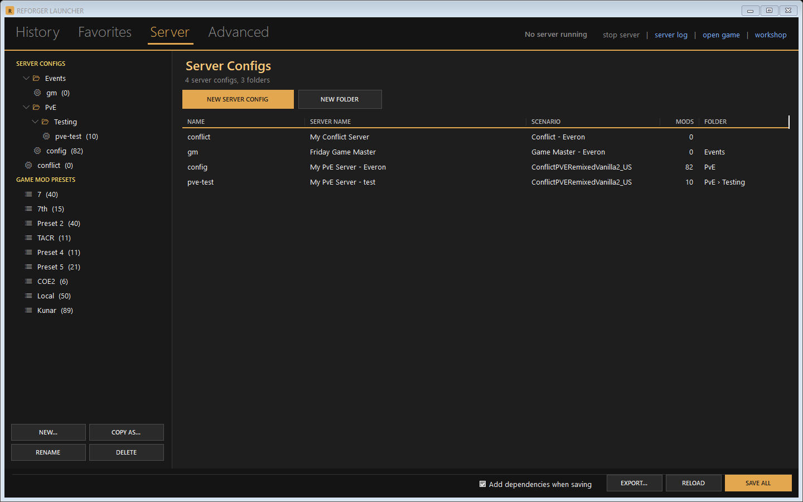
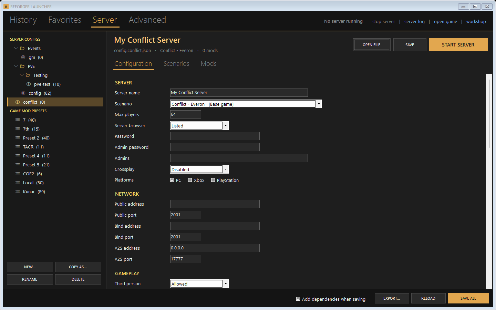
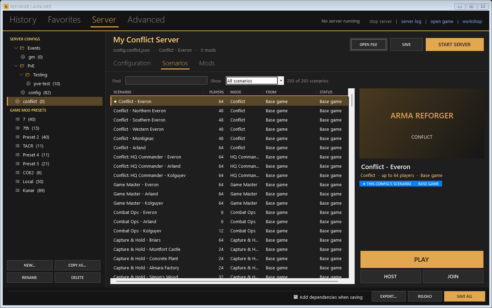

# Reforger Launcher

A Windows launcher for **Arma Reforger** players and people who host their own dedicated server. Its layout is modelled
on [A3Launcher](https://a3launcher.com) and it uses Arma Reforger's own UI colours. It does the following:

- lists the servers you've joined, with the exact mods each one loaded, and joins them straight from the launcher
- edits your dedicated-server configs (`config*.json`), with every setting the server knows, and keeps them in folders
- browses every scenario on your PC, and plays, hosts or joins it
- edits the game's own mod presets, the lists in its in-game mod manager



## Download

Get **`ReforgerLauncher-win-x64.zip`** from [Releases](../../releases). It holds `ReforgerLauncher.exe` and a
`start-server.bat`.

**Requirements:**

- Windows 10 or 11 (x64)
- [.NET 10 Desktop Runtime (x64)](https://dotnet.microsoft.com/download/dotnet/10.0)
- Arma Reforger through Steam
- To host: the **Arma Reforger Server** tool (Steam → Library → Tools)

Unzip it into the folder where you keep (or want) your server configs. The launcher works on the folder it sits in:

| File | What it is |
|---|---|
| `config*.json` | Your server configs: `config.json`, `config.pve.json`, ... Make new ones in the launcher. |
| `start-server.bat` | Starts the dedicated server with a config and restarts it if it exits. The launcher's START SERVER runs it. |
| `launcher.json` | Written by the launcher: joined servers, favorites, launch options, config folders. |
| `addons\` | Mods the dedicated server downloads (`-addonDownloadDir`). |
| `mod-src\` | Optional: unpublished mod projects (Workbench `addon.gproj`), listed with their scenarios so you can PLAY them. |

The launcher finds the game and the dedicated server in your Steam libraries itself.

## Tabs

**History** shows every server the game has joined, newest first. It reads them from the game's own logs
(`Documents\My Games\ArmaReforger\logs`), including the exact mods it loaded for each server, and keeps them in
`launcher.json` (the game deletes old logs). Each row shows:

- a star
- the name, over the address, mod count, version and last join
- a lock if the server has a password
- the scenario, players and ping, from Steam's A2S server query
- buttons to refresh, list the players, and **join**

**Join** starts the game straight onto the server with those mods (`-client -addr IP:port -addons ...`). If some of
the mods aren't downloaded yet, it opens the game instead, so its browser can download them. There are filters for
name, full, empty, password, offline and scenario.

**Favorites** shows your starred servers, plus servers added by address (**Add server...**).

> Reforger has no public list of every server that a third-party launcher can read. The game's browser needs its
> login, BattleMetrics' API needs a paid key, and Reforger servers don't register with Steam. That's why the server
> list is built from your own history.

**Server** has two parts:

- **The left side** lists your server configs, in folders, then the game's mod presets.
  - Folders can nest as deep as you like. They exist only in the launcher; the files stay next to `start-server.bat`.
  - Right-click any line to rename, move, copy (config ↔ preset), start, open or delete it.
  - Drag configs and folders into folders. F2 renames.
- **A selected config** shows its name, file, scenario and mods, with **START SERVER**, **Save** and **Open file**. It
  has three tabs:
  - **Configuration**: every setting of the dedicated server, with the value in the file, edited in place.
    - The fields, ranges and help come from the server's own schema (`DSConfigSchema.json`). Hover a setting's name
      for its help.
    - A grey name isn't in the file, so the server uses its default. Emptying a field removes it from the file.
    - Invalid values turn red and aren't saved. Settings the editor doesn't know are kept, and shown as JSON.
  - **Scenarios**: every scenario on your PC (base game, downloaded mods, `mod-src\` projects), like the game's
    scenario browser.
    - **PLAY** runs it on this PC with the list's mods: a local dedicated server for multiplayer scenarios, which the
      game joins by itself.
    - **HOST** makes it the config's scenario and starts the server. On a game preset, it makes a new config instead.
    - **JOIN** joins a running server.
  - **Mods**: every mod on your PC, ticked = in this list. You can also add mods from pasted text: GUIDs, workshop
    links, a server config, or the game's mod export.

  A game preset shows only the Scenarios and Mods tabs.

**Advanced** holds the game's launch options (window, max FPS, no sound, extra parameters), which PLAY, JOIN and
*open game* use, and the folders in use.

**Top right** shows the running server's name and the address it registered with the server browser (read from its
log). Hover it for the direct join code. Next to it are *stop server*, *server log*, *open game* and *workshop*.




## Notes

- **Close the game before saving mod presets.** The game rewrites its settings file when it exits, which would undo
  the change. Every preset save first backs up that file to `mod-presets-backups\` (the last 20 are kept).
- *Add dependencies when saving* adds every mod the ticked mods need. It reads them from each mod's info, a project's
  `addon.gproj`, or the mod's workshop page.
- The dedicated server downloads its mods from the Workshop, so unpublished mods only work with PLAY.
- Others can only join your server if its public port (UDP, 2001 by default) is forwarded to your PC.

## Building

You need the .NET 10 SDK.

```powershell
.\build.ps1 -Out C:\path\to\your\server\folder
```

This publishes a single `ReforgerLauncher.exe` (framework-dependent, about 450 KB). Without `-Out`, it goes into the
folder above this one.

Command-line options:

| Option | What it does |
|---|---|
| `--root <folder>` | Work on another folder. |
| `--settings <file>` | Use another game settings file. |
| `--addons <folder>` | Use another mods folder. |
| `--offline` | No workshop lookups. |
| `--snap <folder>` | Open off-screen, save a picture of every tab, and exit. |

`make-icon.ps1` redraws `launcher.ico`.

---

Not affiliated with or endorsed by Bohemia Interactive. Arma and Arma Reforger are trademarks of Bohemia Interactive a.s.
